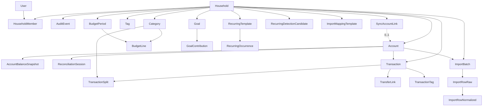
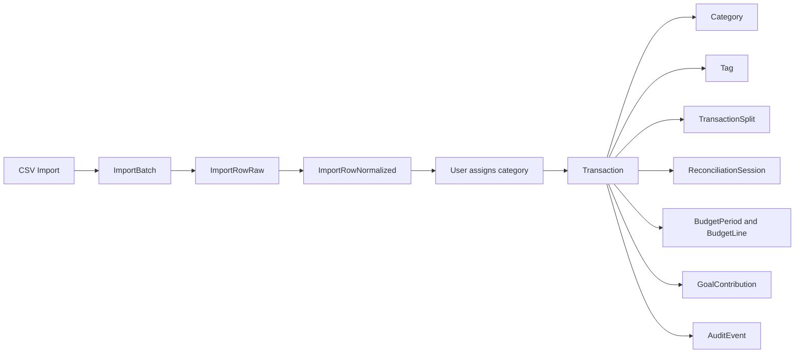
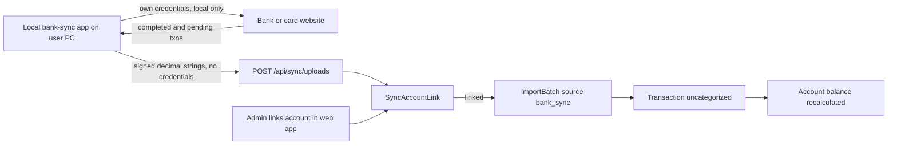

# Domain model

```yaml
version: 2.2.0
last_updated: 2026-11-25
breaking: "no"
```

## Entity glossary

| Entity | One-line definition |
|--------|---------------------|
| `Household` | Tenant root; owns currency and timezone. |
| `User` | Login identity; can belong to many households via membership. |
| `HouseholdMember` | Join of user to household with role. |
| `Session` | Server-side login session (HTTP-only cookie); resolves to one user + household membership. |
| `AuditEvent` | Lightweight append-only activity log for accountability. |
| `Account` | Financial container (checking, credit, etc.) with balances. |
| `AccountBalanceSnapshot` | Point-in-time balance for history and reconciliation context. |
| `ReconciliationSession` | One reconciliation attempt for an account over a statement period. |
| `Transaction` | Single posting: income, expense, or one leg of a transfer. |
| `TransferLink` | Pairs two transactions as one logical transfer. |
| `TransactionSplit` | Allocates part of one transaction to a category. |
| `TransactionTag` | Many-to-many link transaction ↔ tag. |
| `Category` | Hierarchical classification, seeded from the default list per household; user-assigned only; budget lines attach here. |
| `Tag` | Cross-cutting label. |
| `BudgetPeriod` | Annual planning bucket (one per year). |
| `BudgetLine` | Annual planned amount per category (income or expense) within a period; monthly view derived as ÷ 12. Expected/current profit = income − expenses, derived. |
| `Goal` | Savings or paydown target. |
| `GoalContribution` | Movement toward a goal (manual or linked to transaction). |
| `RecurringTemplate` | Definition of expected recurring cashflow. |
| `RecurringOccurrence` | One expected instance (due date, match state). |
| `RecurringDetectionCandidate` | Suggested template from pattern mining. |
| `ImportBatch` | One upload/import run for an account. |
| `ImportRowRaw` | Unparsed CSV row payload. |
| `ImportRowNormalized` | Parsed row ready for dedupe and promotion. |
| `ImportMappingTemplate` | Saved column mapping for repeat imports. |
| `SyncAccountLink` | Maps one bank/card provider account number (seen by bank sync) to a household `Account`, or marks it unmapped/ignored. |

**Actors outside the server:** the **local bank-sync app** (`apps/bank-sync`) runs on a household admin's computer, holds the provider credentials in a local encrypted vault and calls the API with that admin's normal session. There is **no server-side credential or connection entity**: bank credentials never reach the API or the database.

## Relationship diagram (ERD)

High-level ownership and foreign keys. Implementation may add indexes and soft-delete columns per [03-entities-fields.md](03-entities-fields.md).



## Transaction-centric data flow



## Bank & card auto-fetch flow



The server skips pending, zero and foreign-currency rows, derives `type` from the sign, takes the Asia/Jerusalem calendar date, and dedupes on `(account_id, external_ref)`. Rows of `unmapped` accounts are not stored; the local app re-scans that window on the next sync.

## References

- Field-level spec: [03-entities-fields.md](03-entities-fields.md)
- Enums: [05-enums-and-statuses.md](05-enums-and-statuses.md)
